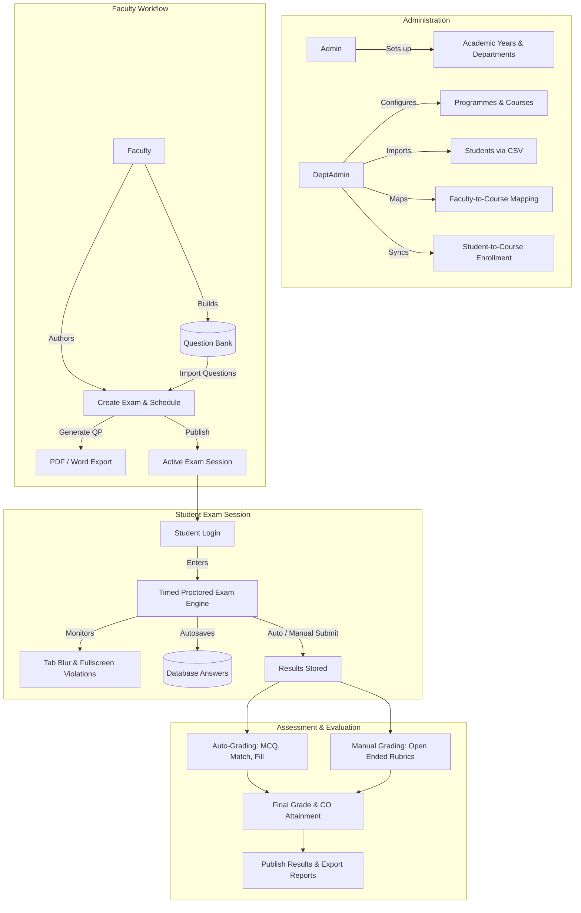

# 🎓 MITS Internal Assessment Portal

[](https://www.php.net/)
[](https://www.mysql.com/)
[](https://getbootstrap.com/)
[](https://getcomposer.org/)
[](#)

A centralized, enterprise-grade **Computer-Based Examination (CBT), Question Bank, and Internal Assessment Management System** built for **Muthoot Institute of Technology and Science (MITS)**. 

The portal digitizes and streamlines the entire institutional examination lifecycle — including Course Outcome (CO) mapping for Outcome-Based Education (OBE), dynamic exam authoring, question banking with LaTeX math formula support, proctored test taking with tab-switching detection, automated objective grading, rubric-based manual evaluation, and institutional grade reporting.

---

## 📑 Table of Contents

- [Overview & Architecture](#-overview--architecture)
- [Key Features by Role](#-key-features-by-role)
  - [1. Super Administrator (Admin)](#1-super-administrator-admin)
  - [2. Department Administrator (DeptAdmin)](#2-department-administrator-deptadmin)
  - [3. Faculty / Examiner](#3-faculty--examiner)
  - [4. Student / Examinee](#4-student--examinee)
- [System Architecture & Workflow](#-system-architecture--workflow)
- [Technology Stack](#-technology-stack)
- [Directory Structure](#-directory-structure)
- [Database Schema & Models](#-database-schema--models)
- [Question Bank & Supported Formats](#-question-bank--supported-formats)
- [Proctoring & Anti-Cheat System](#-proctoring--anti-cheat-system)
- [Installation & Local Setup](#-installation--local-setup)
- [Environment Configuration (.env)](#-environment-configuration-env)
- [Usage Guidelines & Workflows](#-usage-guidelines--workflows)
- [Troubleshooting & FAQs](#-troubleshooting--faqs)

---

## 🏛️ Overview & Architecture

The **MITS Internal Assessment Portal** is designed to replace manual pen-and-paper or disparate online quiz tools with a unified, role-based institutional assessment engine. It enforces academic hierarchy and strict isolation across departments while maintaining centralized oversight for the Exam Cell.

### Core Value Propositions:
- **Role-Based Access Control (RBAC):** Strict 4-tier user segmentation (`Admin`, `DeptAdmin`, `Faculty`, `Student`).
- **Outcome-Based Education (OBE) Integration:** Questions and exams are linked directly to Course Outcomes (CO1 through CO5) to automate NBA/NAAC attainment calculations.
- **Rich Assessment Types:** Supports Multiple Choice (MCQ), Match the Following, Fill in the Blanks, and Open-Ended / Subjective Questions.
- **STEM / Math Equation Support:** Integrated **MathLive** equation editor for typing LaTeX mathematical notations and equations directly into questions.
- **Automated & Manual Grading:** Instant evaluation of objective questions combined with an intuitive rubric-scoring workbench for descriptive responses.
- **Export Capabilities:** Automated generation of official Question Papers in PDF (TCPDF) and MS Word (`.docx`) format (PHPWord), along with student performance CSV/Excel sheets.

---

## 👥 Key Features by Role

### 1. Super Administrator (Admin)
* **Institutional Dashboard:** High-level metrics tracking total departments, faculty members, registered students, and active assessments.
* **Academic Year Management:** Define and transition academic years (`AY_ID`, `AY_Name`).
* **Department Management:** Add, configure, and maintain academic departments.
* **Faculty Directory:** Onboard instructors, maintain designations, emails, contact details, and department affiliations.
* **Global Student Directory:** Institution-wide view of enrolled students.
* **Exam & Result Monitoring:** View all scheduled and completed exams across all college departments with institutional result analytics.

### 2. Department Administrator (DeptAdmin)
* **Departmental Oversight:** Head of Department (HOD) / Department Coordinator control panel.
* **Programme Management:** Manage degree programmes (e.g., B.Tech Computer Science, Artificial Intelligence, Civil, Mechanical, etc.).
* **Course Catalog:** Create courses with code, name, credit weightage, semester, and target academic year.
* **Course-to-Faculty Mapping:** Assign one or multiple faculty members to specific departmental courses per academic session.
* **Bulk Student Onboarding:** Upload Students using CSV templates (`Student Template.csv`), automatically generating secure portal login accounts.
* **Student-Course Enrollment Sync:** Dynamically map students to course offerings based on branch, semester, and academic year.
* **Departmental Reports:** Track department-specific exam participation and score distributions.

### 3. Faculty / Examiner
* **Question Bank Management:**
  * Build reusable, course-mapped question banks.
  * Tag questions with Course Outcomes (CO), marks, rubrics, and word limits.
  * Attach reference diagrams or schematics directly to questions.
  * Bulk import questions via structured Excel spreadsheets (`MCQ_Template.xlsx`, `Matching_Template.xlsx`, `Open_Ended_Template.xlsx`, `Statement_Filling_Template.xlsx`).
* **Exam Authoring & Publishing:**
  * Create timed internal exams (duration in minutes, start time, end time).
  * Selectively draw from existing question banks or author new questions on the fly.
  * Publish exams to make them accessible to enrolled students within the scheduled window.
* **Question Paper Generation:**
  * Export formatted institutional question papers directly to **PDF** (via TCPDF) or **Microsoft Word (.docx)** (via PHPWord).
* **Evaluation & Grading Workbench:**
  * Automatic calculation of objective sections.
  * Dedicated grading view (`enter-marks.php`) for subjective open-ended answers with rubric references and grader comments.
  * Recalculate marks and update score statuses (`pending_review`, `graded`, `published`).
  * Export student marks, percentage, and CO attainment breakdowns to Excel/CSV.

### 4. Student / Examinee
* **Personalized Student Dashboard:** View enrolled courses and currently active/upcoming assessments.
* **Secure CBT Exam Interface (`attempt-exam-new.php`):**
  * **Interactive Question Palette:** Dynamic color-coded status tracker (*Answered*, *Visited*, *Marked for Review*, *Not Visited*).
  * **Live Synchronized Timer:** Real-time countdown clock with automatic submission upon timer expiration.
  * **Answer Autosave:** Background synchronization to ensure zero answer loss during intermittent network drops.
  * **Proctoring & Violation Counter:** Active tracking of browser tab switches, window blurs, and fullscreen cancellations.
* **Results & Performance:** Access graded scorecards and review feedback once released by faculty.

---

## 🔄 System Architecture & Workflow



---

## 💻 Technology Stack

| Layer | Technologies / Libraries | Purpose |
|---|---|---|
| **Backend** | PHP 7.4 / 8.0+ | Core application logic, REST endpoints, session handling |
| **Database** | MySQL 5.7+ / MariaDB 10.3+ | Relational schema, JSON fields, virtual computed columns |
| **Web Server** | Apache (mod_rewrite enabled) | HTTP request handling, virtual routing |
| **Dependency Management** | Composer | Dependency tracking and autoloading |
| **Frontend Framework** | HTML5, Vanilla JavaScript, CSS3 | Layout structure, exam interactivity, local autosave |
| **UI Components** | Bootstrap 5.3.3 | Responsive layouts, grid system, modal dialogues |
| **Iconography & Styling** | Bootstrap Icons 1.13, FontAwesome 6.5 | UI visual iconography |
| **Typography** | Google Fonts (*Solway*) | Typography consistency |
| **Formula & Math Editor** | MathLive | LaTeX math and scientific equation rendering & input |
| **Document Export** | TCPDF 7.0 & PHPWord 1.4 | Automated Question Paper & report generation (PDF / DOCX) |
| **Email Services** | PHPMailer 7.1 | Transactional SMTP emails (token-based password resets) |
| **Environment Config** | vlucas/phpdotenv 5.6 | Secure `.env` variable parsing |
| **Interactive Modals** | SweetAlert2, Select2 | Toast notifications, dialogs, searchable drop-downs |

---

## 📂 Directory Structure

```text
MITS-Exam/
├── .env.example              # Sample environment configuration template
├── .htaccess                 # Apache rewrite rules & security restrictions
├── composer.json             # Composer package manifest
├── composer.lock             # Locked vendor dependencies
├── favicon.ico               # Portal icon
├── index.php                 # Central entrypoint & role-based authentication handler
│
├── Admin/                    # Super Admin Module
│   ├── academic-year.php     # Manage Academic Years
│   ├── dashboard.php         # Admin metrics & high-level overview
│   ├── delete.php            # Unified deletion handlers
│   ├── edit-exam.php         # Exam modification utility
│   ├── manage-department.php # Add/edit/remove academic departments
│   ├── manage-faculty.php    # Manage faculty records and logins
│   ├── manage-students.php   # Institution-level student records
│   ├── view-exams.php        # Global examination directory
│   └── view-results.php      # Institution-wide result analytics
│
├── DeptAdmin/                # Department Administrator Module
│   ├── dashboard.php         # Departmental KPIs & quick actions
│   ├── manage-courses.php    # Course catalog (Code, Name, Credits, Sem)
│   ├── manage-faculty.php    # Department faculty directory
│   ├── manage-programmes.php # Degree & branch programme definitions
│   ├── manage-student.php    # Student management & batch CSV import
│   ├── map-courses.php       # Allocate courses to faculty members
│   ├── sync-student-courses.php # Sync enrolled students to semester courses
│   ├── view-exams.php        # Department exams overview
│   └── view-results.php      # Department performance reports
│
├── Faculty/                  # Faculty / Examiner Module
│   ├── api.php               # Core AJAX API endpoint for Exam Builder & Bank
│   ├── create-exam.php       # Interactive exam builder interface
│   ├── create-newexam.php    # Alternative streamlined exam creation flow
│   ├── dashboard.php         # Faculty course overview & exam quicklinks
│   ├── download-qp.php       # Export question paper (PDF/Word)
│   ├── enter-marks.php       # Subjective grading & rubric assessment
│   ├── export-results.php    # Export student marks to CSV/Excel
│   ├── manage-exam.php       # View and maintain created exams
│   ├── question-bank.php     # Question bank repository and search
│   ├── recalculate-results.php # Recompute scores upon answer key updates
│   ├── view-courses.php      # List of allocated subjects
│   └── view-results.php      # Student marksheets and CO attainment
│
├── Student/                  # Student / Examinee Module
│   ├── attempt-exam-new.php  # Proctored online examination engine
│   ├── dashboard.php         # Active courses & scheduled exams
│   ├── submit-exam.php       # Exam submission & score processing
│   ├── view-courses.php      # Enrolled subjects list
│   └── view-exams.php        # Assessment calendar
│
├── Common/                   # Reusable Partial Views
│   ├── header.php            # Navigation header & user profile status
│   ├── footer.php            # Global footer markup
│   ├── admin-sidebar.php     # Admin navigation drawer
│   ├── deptadmin-sidebar.php # DeptAdmin navigation drawer
│   ├── faculty-sidebar.php   # Faculty navigation drawer
│   └── student-sidebar.php   # Student navigation drawer
│
├── Connection/               # Database Connection & Config
│   └── connection.php        # MySQLi connection initializer with Dotenv support
│
├── Database/                 # Database Migrations & Schemas
│   ├── Database Schema.sql   # Primary DDL schema with tables, keys & indexes
│   ├── schema.sql            # Supplemental schema scripts
│   └── exam_db.sql           # Baseline database dump
│
├── Login/                    # Authentication & Password Recovery
│   ├── forgot-password.php   # Generates reset token & sends SMTP email
│   ├── login.php             # Login processing script
│   ├── logout.php            # Destroys session and redirects
│   └── reset-password.php    # Password reset verification & update form
│
├── Templates/                # Formatted Excel/CSV Import Templates
│   ├── Courses_Template.csv  # Template for bulk course catalog import
│   ├── Faculty_Template.csv  # Template for faculty records
│   ├── Student Template.csv  # Template for batch student onboarding
│   ├── MCQ_Template.xlsx     # Template for Multiple Choice Questions
│   ├── Matching_Template.xlsx # Template for Match the Following pairs
│   ├── Open_Ended_Template.xlsx # Template for Subjective Questions
│   └── Statement_Filling_Template.xlsx # Template for Fill-in-the-Blank Questions
│
├── Css/                      # Stylesheets
│   └── style.css             # Main theme styles & Solway font rules
│
└── Images/                   # Graphics & Institutional Assets
    └── MITS Logo.png         # Institution logo
```

---

## 🗄️ Database Schema & Models

The database utilizes MySQL/MariaDB with `InnoDB` storage engines, JSON columns for flexible dynamic question options, and virtual generated columns for instant percentage and text lookups.

### Primary Entities & Relationships:

| Table Name | Description | Key Columns |
|---|---|---|
| `login` | Authentication credentials & system roles | `User_ID`, `Password`, `Role` (Admin, DeptAdmin, Faculty, Student), `Status` |
| `department` | Academic departments | `Dept_ID`, `Dept_Name`, `Dept_Code` |
| `programmes` | Academic degrees (e.g., B.Tech, M.Tech) | `Prog_ID`, `Dept_ID`, `Prog_Name` |
| `courses` | Course catalog | `Course_ID`, `Dept_ID`, `Prog_ID`, `Course_Code`, `Course_Name`, `Credits`, `Semester` |
| `course_mapping` | Assignment of courses to faculty | `Map_ID`, `Course_ID`, `Fac_ID`, `Dept_ID`, `Acad_Year` |
| `student` | Student biodata & roll numbers | `Stud_ID`, `Stud_Name`, `Stud_Email`, `Stud_Dept`, `Stud_Prog`, `Stud_Branch`, `Stud_Year` |
| `student_course_mapping` | Enrollment of students into courses | `Map_ID`, `Stud_ID`, `Course_ID`, `Fac_ID`, `Semester`, `Acad_Year` |
| `exams` | Assessment headers and schedules | `Exam_ID`, `Course_ID`, `Fac_ID`, `Exam_Name`, `Duration`, `Start_Time`, `End_Time`, `Status` |
| `exam_questions` | Questions bound to a specific exam | `Question_ID`, `Exam_ID`, `Question_Type`, `Marks`, `CO`, `Options_JSON`, `Answers_JSON`, `Pairs_JSON`, `Image_Path` |
| `new_question_bank` | Central reusable repository of questions | `Bank_ID`, `Course_ID`, `Fac_ID`, `Question_Type`, `Marks`, `CO`, `Rubric`, `Options_JSON` |
| `results` | Student exam attempt records | `Result_ID`, `Exam_ID`, `Stud_ID`, `Total_Marks`, `Marks_Obtained`, `Percentage`, `Violations`, `Status` |
| `result_answers` | Granular response per question | `Answer_ID`, `Result_ID`, `Question_ID`, `Student_Answer`, `Marks_Awarded`, `Is_Correct`, `Answer_Status` |
| `password_resets` | Secure tokens for password recovery | `id`, `user_id`, `token`, `expires_at`, `created_at` |

---

## 📝 Question Bank & Supported Formats

Faculty can curate questions either directly through the interactive web UI or by downloading and populating pre-formatted templates located in the `Templates/` folder:

1. **Multiple Choice Questions (`MCQ_Template.xlsx`):**
   * Fields: Question text, Options (A, B, C, D), Correct Option, Marks, Course Outcome (CO).
   * Optional reference diagram or schematic image.
2. **Match the Following (`Matching_Template.xlsx`):**
   * Stores pairs in column format; presented to students in randomized order for interactive pairing.
3. **Fill in the Blanks / Statement Filling (`Statement_Filling_Template.xlsx`):**
   * Sentences containing blank markers (`[blank]`) paired with accepted matching keywords.
4. **Open-Ended / Subjective (`Open_Ended_Template.xlsx`):**
   * Essay, analytical, or descriptive questions with configurable **Word Limits** and structured **Grading Rubrics**.

---

## 🛡️ Proctoring & Anti-Cheat System

The student examination interface (`Student/attempt-exam-new.php`) includes built-in browser-level proctoring mechanisms to ensure academic integrity:

* **Tab Switching & Blur Detection:** Listens to `window.onblur` and `document.visibilitychange`. If the student switches browser tabs or minimizes the window, a warning is triggered, and a violation counter is incremented.
* **Violation Logging:** Total recorded infractions (`Violations`) are submitted alongside the answers and displayed on the faculty's grading sheet.
* **Auto-Submission on Timer Expiration:** When the allocated duration runs out, the test client automatically locks inputs and executes an asynchronous `POST` submission to `Student/submit-exam.php`.
* **State Persistence:** Selections are automatically buffered in local state, preventing answers from being discarded in the event of an accidental page reload.

---

## 🚀 Installation & Local Setup

### Prerequisites
* **XAMPP / WAMP / LAMP** or standalone Apache with **PHP 7.4 or 8.0+**
* **MySQL 5.7+** or **MariaDB 10.3+**
* **Composer** ([Download Composer](https://getcomposer.org/))
* Git installed on your local machine

---

### Step-by-Step Installation

#### 1. Clone the Repository
Clone the codebase into your web root directory (e.g., `C:/xampp/htdocs/` for XAMPP on Windows):
```bash
cd C:\xampp\htdocs
git clone https://github.com/AnirudhJBhatt/MITS-Exam.git
cd MITS-Exam
```

#### 2. Install PHP Dependencies via Composer
Run Composer to install all required production vendor packages:
```bash
composer install --no-dev --optimize-autoloader
```
*Packages installed include `PHPMailer`, `TCPDF`, `PHPWord`, and `phpdotenv`.*

#### 3. Setup the Database
1. Start **Apache** and **MySQL** services via the XAMPP Control Panel.
2. Open your browser and navigate to **phpMyAdmin** (`http://localhost/phpmyadmin`).
3. Create a new database named:
   ```sql
   CREATE DATABASE mits_exam_portal CHARACTER SET utf8mb4 COLLATE utf8mb4_unicode_ci;
   ```
4. Import the schema file located at:
   ```text
   Database/Database Schema.sql
   ```
   *(Optionally, you can also import baseline data from `Database/exam_db.sql` if provided).*

#### 4. Configure Environment Variables
Copy the sample environment file to create your local `.env`:
```bash
copy .env.example .env
```
Open `.env` in a text editor and configure your database and SMTP parameters:
```ini
# Database Configuration
DB_HOST=localhost
DB_PORT=3306
DB_USER=root
DB_PASSWORD=
DB_NAME=mits_exam_portal

# SMTP Configuration (PHPMailer for Password Resets)
SMTP_HOST=smtp.gmail.com
SMTP_PORT=587
SMTP_USER=your_institution_email@mgmits.ac.in
SMTP_PASS=your_google_app_password
SMTP_SECURE=tls
SMTP_FROM_EMAIL=your_institution_email@mgmits.ac.in
SMTP_FROM_NAME="MITS Internal Assessment Portal"
```

#### 5. Verify Permissions
Ensure that the web server has write permissions to:
* The root directory (for file uploads / question images)
* `vendor/` (if updating dependencies)

#### 6. Access the Application
Open your browser and navigate to:
```text
http://localhost/MITS-Exam/
```

---

## 🔐 Default Access & Authentication

User accounts are mapped through the `login` table. Role designations are case-sensitive:

| Role Identifier | Landing URL | Typical Responsibilities |
|---|---|---|
| `Admin` | `/Admin/dashboard.php` | Controller of Examinations / System Administrator |
| `DeptAdmin` | `/DeptAdmin/dashboard.php` | Head of Department / Academic Coordinator |
| `Faculty` | `/Faculty/dashboard.php` | Subject Instructor / Examiner |
| `Student` | `/Student/dashboard.php` | Candidate / Student |

> **Note on Initial Passwords:** When students are imported in bulk via `DeptAdmin/manage-student.php`, default accounts are generated with the initial password:
> ```text
> Password: Student123*
> ```
> Students can change their passwords upon logging in or initiate a token-based reset using the **Forgot Password** link on the login screen.

---

## 📖 Usage Guidelines & Workflows

### Complete Assessment Lifecycle:

1. **Course & Student Preparation (DeptAdmin):**
   * Register academic programmes and courses.
   * Upload student cohort via CSV.
   * Assign faculty to courses in **Map Courses**.
   * Run **Sync Student Courses** to enroll students into their registered semester subjects.

2. **Exam Creation & Question Banking (Faculty):**
   * Navigate to **Question Bank** and populate questions manually or via Excel templates.
   * Click **Create Exam**, select the target course, set duration and start/end time windows.
   * Pull questions from the question bank or add custom items.
   * Review and **Publish** the exam.
   * *(Optional)* Download the generated Question Paper in PDF or DOCX format for official records.

3. **Taking the Exam (Student):**
   * Log into the student portal during the scheduled time window.
   * Access the assessment from the dashboard and click **Start Exam**.
   * Navigate through questions, review responses, and click **Submit Exam** (or let the countdown timer submit automatically).

4. **Grading & Publishing Results (Faculty):**
   * Open **View Results** and select the completed exam.
   * Review objective scores (auto-graded).
   * Grade open-ended responses in **Enter Marks** using the rubric guideline.
   * Click **Publish Results** to release marks and export the final report to Excel/CSV.

---

## ❓ Troubleshooting & FAQs

### 1. "Failed to connect" Database Error
* Ensure MySQL service is running in your XAMPP/WAMP control panel.
* Check that credentials in `.env` match your local MySQL configuration (`DB_USER`, `DB_PASSWORD`, `DB_PORT`, and `DB_NAME`).

### 2. Password Reset Emails Failing to Send
* Ensure `SMTP_USER` and `SMTP_PASS` in `.env` are valid.
* For Gmail accounts, you must generate a **Google App Password** (regular account passwords will be rejected by Google's SMTP servers).

### 3. LaTeX / Math Formulas Not Rendering
* Math rendering relies on **MathLive**, which is loaded via CDN in `Common/header.php`. Ensure your development environment has active internet access.

### 4. TCPDF or PHPWord Missing Classes
* Verify that you executed `composer install` inside the project root and that the `vendor/` directory contains `tecnickcom/tcpdf` and `phpoffice/phpword`.

---

## 📄 License & Attribution

Developed for **Muthoot Institute of Technology and Science (MITS)**.  
Repository maintained by [Anirudh J Bhatt](https://github.com/AnirudhJBhatt).  
*All rights reserved. Unauthorized distribution, copying, or modification without institutional consent is strictly prohibited.*
