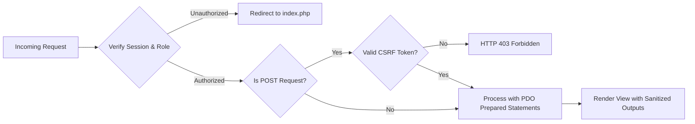

# 🚀 Implementation Plan: MITS Exam Portal Rebuild (Simple, Secure & Modern UI/UX)

A comprehensive, practical implementation plan to rebuild the **MITS Internal Assessment Portal** from the ground up. 

This plan retains the **simple, intuitive, role-based PHP architecture** (no complex MVC or heavy frameworks), while simultaneously overhauling **Security, Data Integrity, and the entire UI/UX Design System**.

---

## 🎨 UI/UX Overhaul & Modern Design System

### 1. Fix Core HTML & Layout Bugs (Current Pain Points)
* **Invalid Markup Nesting:** Currently, [Common/header.php](file:///c:/xampp/htdocs/MITS-Exam/Common/header.php#L110-L112) prematurely closes `</body></html>`. When child pages include `header.php` and then declare their own `<body>`, browsers encounter broken duplicate DOM trees causing layout instability.
  * **Fix:** `Common/header.php` will open the `<!DOCTYPE html>`, `<head>`, render the top `<nav>`, and open the `<div class="app-layout">` wrapper. `Common/footer.php` will cleanly close the container, load scripts, and close `</body></html>`.
* **Broken Stylesheet Links:** In pages like [DeptAdmin/dashboard.php:22](file:///c:/xampp/htdocs/MITS-Exam/DeptAdmin/dashboard.php#L22), the CSS links to `../Common/style.css` (which doesn't exist).
  * **Fix:** Centralize all styles into a single, cohesive stylesheet: `Css/style.css`.
* **Font Inconsistencies:** The current project mixes `Solway` (serif), `Inter` (sans-serif), and browser defaults.
  * **Fix:** Standardize on **Inter** (modern, clean, and highly legible for assessment systems and data tables).

---

### 2. Modern Design Tokens & Theme

| Token | Value / Spec | Usage |
|---|---|---|
| **Primary Brand** | MITS Crimson `#d1202d` | Brand accents, active links, primary buttons, badges |
| **Secondary Accent** | Slate Indigo `#3B82F6` | Info badges, active question highlight, timers |
| **Background** | Clean Off-White `#F8FAFC` | Page background (reduces eye strain during exams) |
| **Surface / Card** | Pure White `#FFFFFF` with `border: 1px solid #E2E8F0` | Clean cards, elevated shadows (`box-shadow: 0 1px 3px rgba(0,0,0,0.05)`) |
| **Typography** | `Inter`, -apple-system, sans-serif | 100% unified across Admin, Faculty, and Student portals |
| **Status Colors** | Success `#10B981`, Warning `#F59E0B`, Danger `#EF4444` | Question status indicators, score badges, alerts |

---

### 3. Responsive Mobile & Tablet Experience
* **The Problem:** The current `main` tag has a hardcoded `margin-left: 260px` with no media queries. On phones and tablets (<768px), the layout squishes or gets cut off.
* **The Solution:**
  * **Desktop (≥992px):** Smooth collapsible sidebar (`260px` expanded $\rightarrow$ `78px` compact icon-only view).
  * **Mobile (<992px):** Offcanvas sliding drawer with a semi-transparent dark backdrop overlay (`rgba(0,0,0,0.5)`). Tapping outside or clicking a link automatically closes the drawer.

---

### 4. Interactive Feedback: Kill Ugly `alert()` Popups
* **Current Issue:** Nearly all forms trigger blocking browser `alert("...")` boxes and instant `window.location=...` redirects.
* **Modern Replacement:**
  * **SweetAlert2 Toasts:** Non-blocking, beautiful toast notifications in the top-right corner for quick actions (e.g., *"Draft autosaved"*, *"Question added successfully"*).
  * **Confirmation Modals:** Clean animated modal prompts for destructive actions (e.g., *"Are you sure you want to delete this course?"*).
  * **Button Loading Spinners:** On form submission or CSV upload, automatically disable the submit button and display a spinner (`<span class="spinner-border spinner-border-sm"></span> Loading...`) to eliminate duplicate submissions.

---

### 5. Dynamic Dashboards (Replace Hardcoded Numbers)
* **Current Issue:** [Admin/dashboard.php](file:///c:/xampp/htdocs/MITS-Exam/Admin/dashboard.php#L36) and [Faculty/dashboard.php](file:///c:/xampp/htdocs/MITS-Exam/Faculty/dashboard.php#L44) display static, hardcoded text: `"1,250 Registered"`, `"3 Active Exams"`, `"540 Reports"`.
* **The Solution:**
  * Write lightweight aggregate queries (`SELECT COUNT(*) FROM student`, etc.) to show **live, accurate counts**.
  * Add quick action shortcut cards (e.g., *"Create New Exam"*, *"Import Students"*, *"Pending Reviews"*).

---

### 6. Premium Student CBT Exam Interface (`attempt-exam.php`)
* **Large, Accessible Clickable Option Cards:**
  * MCQ and Multiselect options will feature full-width card layouts with subtle hover elevation and clear active/selected radio states.
* **Floating Live Status Pill:**
  * An ambient status badge at the top-right:
    * 🟢 **Saved** (green checkmark) when draft syncs
    * 🟡 **Saving...** (yellow spinner) during background HTTP post
* **Formula & LaTeX Formatting:**
  * Fine-tune **MathLive** styling with inline baseline alignment (`vertical-align: middle`) so equations blend seamlessly with English sentences without line height jumping.
* **Non-Jarring Fullscreen Recovery:**
  * Instead of jarring alerts, show a full-screen blur overlay with a large prominent button: *"Click to Re-enter Fullscreen (Violation Logged)"*.

---

## 📁 Clean & Practical Folder Structure

```text
MITS-Exam/
├── .env                      # Database credentials, SMTP configuration
├── .env.example              # Sample environment template
├── .htaccess                 # Apache rewrite rules & security headers
├── composer.json             # PHPMailer, TCPDF, PHPWord, phpdotenv
├── index.php                 # Redesigned Modern Login Portal
│
├── Common/                   # Core Shared Helpers & Layout Partials
│   ├── connection.php        # Centralized PDO database connection
│   ├── auth.php              # Role authentication guards
│   ├── csrf.php              # CSRF protection helpers
│   ├── header.php            # Clean HTML head & top navbar
│   ├── footer.php            # Unified scripts & closing tags
│   ├── admin-sidebar.php     # Responsive Admin drawer
│   ├── deptadmin-sidebar.php # Responsive DeptAdmin drawer
│   ├── faculty-sidebar.php   # Responsive Faculty drawer
│   └── student-sidebar.php   # Responsive Student drawer
│
├── Admin/                    # Super Admin (Institution Management)
│   ├── dashboard.php         # Real-time metrics & system stats
│   ├── academic-year.php     # Academic Years management
│   ├── manage-department.php # Academic departments
│   ├── manage-faculty.php    # Faculty directory
│   ├── manage-students.php   # Student registry
│   ├── view-exams.php        # College-wide exam timetable
│   └── view-results.php      # Institution-level analytics
│
├── DeptAdmin/                # Department Admin (HOD / Coordinator)
│   ├── dashboard.php         # Department KPIs & quick actions
│   ├── manage-programmes.php # Programmes master
│   ├── manage-courses.php    # Course catalog
│   ├── map-courses.php       # Allocate faculty to courses
│   ├── manage-student.php    # Transactional CSV student onboarding
│   ├── sync-student-courses.php # Batch course enrollment
│   ├── view-exams.php        # Department exams
│   └── view-results.php      # Department performance reports
│
├── Faculty/                  # Faculty / Examiners
│   ├── dashboard.php         # Active courses & pending grading
│   ├── question-bank.php     # Searchable question repository
│   ├── add-questions.php     # MathLive equation question author
│   ├── import-questions.php  # Excel batch question uploader
│   ├── create-exam.php       # Timed exam builder
│   ├── manage-exams.php      # Exam listing & status toggle
│   ├── download-qp.php       # Export QP to PDF & Word DOCX
│   ├── enter-marks.php       # Rubric grading workbench
│   ├── view-results.php      # Marksheet & CO attainment calculator
│   └── export-results.php    # Export scores to CSV/Excel
│
├── Student/                  # Student / Examinee
│   ├── dashboard.php         # Enrolled subjects & active tests
│   ├── view-courses.php      # Registered semester courses
│   ├── view-exams.php        # Exam timetable
│   ├── attempt-exam.php      # Premium proctored CBT interface
│   ├── save-answer.php       # Background AJAX autosave handler
│   ├── submit-exam.php       # Server-validated submission handler
│   └── view-results.php      # Student scorecard & rubric review
│
├── Login/                    # Authentication Flow
│   ├── forgot-password.php   # Generates token & sends email
│   ├── reset-password.php    # Token verification & password reset
│   └── logout.php            # Secure session termination
│
├── Templates/                # Formatted Excel & CSV Templates
├── Database/                 # Database Migrations
│   └── unified_schema.sql    # Clean, consolidated schema
├── Uploads/                  # Question diagrams & schematics
└── Css/                      # Stylesheets
    └── style.css             # Unified Inter font, tokens & responsive styles
```

---

## 🔒 Security Hardening (Integrated into the Simple Design)



1. **Password Security:**
   * Upgrade `login.Password` to `VARCHAR(255)`.
   * Use `password_hash($password, PASSWORD_BCRYPT)` and `password_verify`.
   * Transparently auto-hash old plaintext passwords on the user's first login.
2. **100% Prepared Statements:**
   * Universal PDO parameterized statements (`$stmt = $pdo->prepare(...)`). Zero variable concatenation in SQL strings.
3. **Lightweight CSRF Protection:**
   * Simple helper: `csrf_token()` generates tokens in forms; `verify_csrf()` checks incoming POST requests.
4. **Hardened Session Management:**
   * `session_regenerate_id(true)` upon login.
   * Session cookie parameters set with `HttpOnly`, `SameSite=Lax`, and `Secure` (when HTTPS).

---

## ⚡ High-Value Assessment & OBE Features

1. **Server-Governed Timing & Autosave:**
   * Server determines `expires_at = NOW() + INTERVAL duration MINUTE`.
   * Background autosave (`Student/save-answer.php`) executes on selection or every 30 seconds.
2. **Anti-Cheat Telemetry:**
   * Browser visibility & fullscreen listeners log tab switches with timestamps to `results.Violations`.
3. **Question & Option Randomization:**
   * Toggle to shuffle question order and MCQ option choices to prevent adjacent copying in computer labs.
4. **NBA / NAAC Course Outcome (CO) Attainment Calculator:**
   * Automatically aggregates question-level CO scores in [Faculty/view-results.php](file:///c:/xampp/htdocs/MITS-Exam/Faculty/view-results.php) and computes percentage attainment for accreditation reports.
5. **Atomic CSV Imports:**
   * Student and faculty batch uploads wrapped in PDO transactions with line-by-line validation errors.

---

## 📅 Phased Execution Roadmap

```mermaid
gantt
    title MITS Exam Portal Rebuild Roadmap (Simple, Secure & Modern UI)
    dateFormat  X
    axisFormat Step %d

    section 1. Foundation & Design System
    Consolidated DB Schema (unified_schema.sql)  :1, 2
    CSS Design System (Inter, Tokens, Mobile CSS):2, 3
    Common Helpers (PDO, Auth, CSRF)             :3, 4
    Redesigned Login (index.php) & Bcrypt Auth   :4, 5

    section 2. Administrative & Department Portals
    Admin Dashboard (Real Metrics) & Management  :5, 6
    DeptAdmin: Courses, Mapping & Batch CSV      :6, 8

    section 3. Question Bank & Exam Builder
    Question Bank UI with MathLive & CO Tags     :8, 10
    Exam Builder & QP Export (PDF/Word)          :10, 11

    section 4. Student CBT & Proctoring
    Student CBT Interface & Question Palette     :11, 13
    Background Autosave & Violation Telemetry    :13, 14

    section 5. Evaluation & OBE Analytics
    Rubric Workbench & Live Grading              :14, 15
    CO Attainment Matrix & Result Export         :15, 16
```



---

## 🚀 Execution Steps & Progress

1. **Step 1: Consolidated Database Schema ([Database/unified_schema.sql](file:///c:/xampp/htdocs/MITS-Exam/Database/unified_schema.sql))**  
   ✅ *COMPLETED:* Unified duplicate legacy tables (`exam`, `result`, `new_table` $\rightarrow$ `exams`, `results`, `result_answers`, `question_bank`), expanded `login.Password` to `VARCHAR(255)` for Bcrypt hashes, and added relational foreign keys.
2. **Step 2: Core Helpers & Unified CSS Design System ([Css/style.css](file:///c:/xampp/htdocs/MITS-Exam/Css/style.css))**  
   ✅ *COMPLETED:* Established clean Google Font `Inter`, MITS Crimson `#d1202d` design tokens, responsive desktop collapse & mobile sliding offcanvas drawer (`<992px`), and dual-driver `connection.php` (PDO + MySQLi).
3. **Step 3: Redesigned Login & Password Migration ([index.php](file:///c:/xampp/htdocs/MITS-Exam/index.php))**  
   ✅ *COMPLETED:* Implemented polished split-screen login, CSRF tokens, session hardening, and transparent automatic legacy plaintext $\rightarrow$ Bcrypt migration on user authentication.
4. **Step 4: Administrative & Department Portals ([Admin/](file:///c:/xampp/htdocs/MITS-Exam/Admin/) & [DeptAdmin/](file:///c:/xampp/htdocs/MITS-Exam/DeptAdmin/))**  
   ✅ *COMPLETED:* Rebuilt all 9 Admin modules and 11 DeptAdmin modules with 100% parameterized PDO statements, Bcrypt credentials generation, transactional batch CSV onboarding, interactive AJAX modals, and scorecard analytics.
5. **Step 5: Question Bank & Exam Builder ([Faculty/](file:///c:/xampp/htdocs/MITS-Exam/Faculty/))**  
   ✅ *COMPLETED (Phase 3):* Built MathLive LaTeX equation authoring workbench ([add-questions.php](file:///c:/xampp/htdocs/MITS-Exam/Faculty/add-questions.php)), comprehensive question bank repository with CO1–CO5 and Bloom's classification ([question-bank.php](file:///c:/xampp/htdocs/MITS-Exam/Faculty/question-bank.php)), master exam schedule manager with publishing toggles ([manage-exams.php](file:///c:/xampp/htdocs/MITS-Exam/Faculty/manage-exams.php)), PHPWord official question paper export ([download-qp.php](file:///c:/xampp/htdocs/MITS-Exam/Faculty/download-qp.php)), allocated course hub ([view-courses.php](file:///c:/xampp/htdocs/MITS-Exam/Faculty/view-courses.php)), student roster ([manage-student.php](file:///c:/xampp/htdocs/MITS-Exam/Faculty/manage-student.php)), and Bcrypt security settings ([settings.php](file:///c:/xampp/htdocs/MITS-Exam/Faculty/settings.php)).
6. **Step 6: Student CBT Experience ([Student/](file:///c:/xampp/htdocs/MITS-Exam/Student/))**  
   ✅ *COMPLETED (Phase 4):* Consolidated and modernized student examination environment:
   * Proctored CBT engine ([attempt-exam.php](file:///c:/xampp/htdocs/MITS-Exam/Student/attempt-exam.php)) with fullscreen gate, ambient countdown timer (Green $\rightarrow$ Amber $\rightarrow$ Red), MathLive STEM formulas, multi-format question support (MCQ, Multiselect, Fill, Open, Match), and responsive question palette.
   * Real-time background autosave ([save-answer.php](file:///c:/xampp/htdocs/MITS-Exam/Student/save-answer.php)) persisting drafts to MySQL `exam_drafts` with visual cloud sync indicator and instant crash recovery.
   * Anti-cheat proctoring telemetry logging tab switches with 3 warnings before automated submission, context menu lock, and shortcut blockers.
   * Modern Student Dashboard ([dashboard.php](file:///c:/xampp/htdocs/MITS-Exam/Student/dashboard.php)) with active assessment urgency banner, upcoming exam rosters, and performance KPIs.
   * Filtered assessment catalog ([view-exams.php](file:///c:/xampp/htdocs/MITS-Exam/Student/view-exams.php)), enrolled subjects hub ([view-courses.php](file:///c:/xampp/htdocs/MITS-Exam/Student/view-courses.php)), comprehensive scorecards history ([view-results.php](file:///c:/xampp/htdocs/MITS-Exam/Student/view-results.php)), and Bcrypt security settings ([settings.php](file:///c:/xampp/htdocs/MITS-Exam/Student/settings.php)).
7. **Step 7: Evaluation Workbench & NBA/NAAC Attainment ([Faculty/](file:///c:/xampp/htdocs/MITS-Exam/Faculty/))**  
   ✅ *COMPLETED (Phase 5):* Delivered accreditation-ready evaluation and OBE attainment portal:
   * **Executive Evaluation Workbench ([view-results.php](file:///c:/xampp/htdocs/MITS-Exam/Faculty/view-results.php)):** Parameterized cascade filters (Academic Year $\rightarrow$ Subject Course $\rightarrow$ Examination), aggregate cohort analytics (Cohort size, attendance rate, class average score, passing rate, and review backlog).
   * **NBA / NAAC Course Outcome (CO1–CO5) Attainment Matrix:** Automated calculation of cohort marks awarded, maximum possible attainment, cohort percentage attainment, and NAAC Attainment Level badges (Level 3: $\ge 70\%$, Level 2: $60-69\%$, Level 1: $50-59\%$, Level 0: $<50\%$).
    * **Interactive Rubric Grading Modal ([enter-marks.php](file:///c:/xampp/htdocs/MITS-Exam/Faculty/enter-marks.php)):** In-modal evaluation workbench for grading open-ended essay/code answers against official rubrics, word limit tracking, evaluator feedback commentary, and real-time score tallying.
   * **Itemized Question Performance Modal ([fetch-result-details.php](file:///c:/xampp/htdocs/MITS-Exam/Faculty/fetch-result-details.php)):** Question-by-question breakdown comparing student choices, correct answers, accepted variants, and proctoring telemetry.
   * **Official Printable Scorecard Export ([download-result.php](file:///c:/xampp/htdocs/MITS-Exam/Faculty/download-result.php)):** TCPDF-powered printable student scorecard with MITS header, CO mappings, proctor violations count, and evaluator/HOD signature blocks.
   * **Outcome-Based CSV Report ([export-results.php](file:///c:/xampp/htdocs/MITS-Exam/Faculty/export-results.php)):** Comprehensive spreadsheet export featuring Roll No, Candidate Name, CO1 through CO5 score breakdown, total marks, percentage, and evaluation status.
   * **Instant Student Publication Control:** AJAX toggle to publish or unpublish examination scorecards to student dashboards with one click.